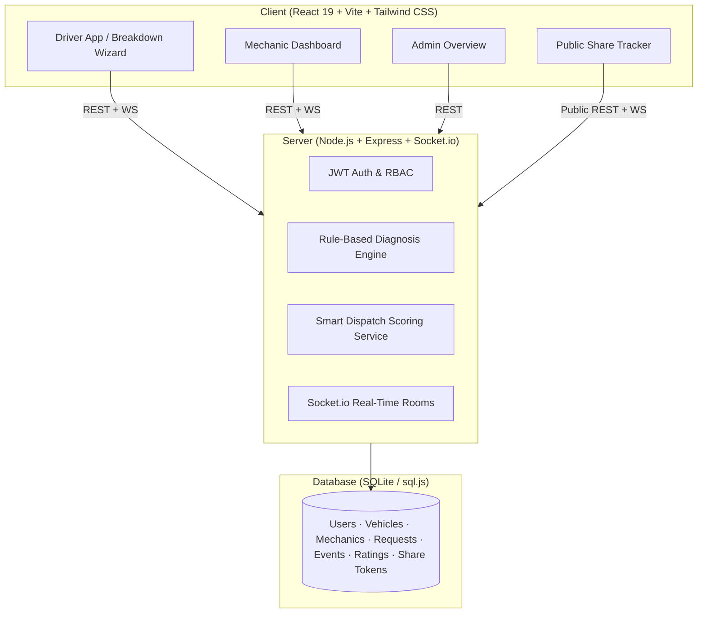

# 🚗 RoadRescue: Smart Car Breakdown Roadside Assistance

RoadRescue is a student-scope full-stack roadside breakdown assistance platform built with React, Vite, Tailwind CSS, Leaflet/OpenStreetMap, Node.js, Express, Socket.io, and SQLite.

---

## 🏛️ Architecture Overview



---

## 🚀 Key Features

1. **Rule-Based Explainable Diagnosis (5 Categories)**:
   - 🔋 **Battery / Electrical**: Detects critically low voltage (<11.8V), charging failure.
   - 🌡️ **Engine Overheating**: Monitors coolant temperature (>100°C 🟠, >110°C 🔴).
   - 🛞 **Tyre / Puncture**: Evaluates 4-corner PSI sensor levels (<25 PSI 🟠, <20 PSI 🔴).
   - ⛽ **Fuel / Fuel System**: Detects empty tank or fuel starvation stall.
   - 🛑 **Brake / Unknown Noise**: Failsafe high-priority triage for vehicle safety.

2. **Novelty 1: Breakdown Black Box & Pre-Arrival Triage**:
   - Stores 60-second telematics history with small trend charts (voltage, coolant, RPM).
   - Assigns severity triage: 🟢 Safe to drive slowly, 🟠 Stop soon, 🔴 Stop NOW.
   - Pre-arrival checklist sent to the mechanic: exact tools & spare parts needed to achieve a first-visit fix.

3. **Novelty 2: Smart Dispatch & Shareable Safety Link**:
   - **Smart Dispatch Score**: `Distance (40%) + Specialization Match (25%) + Rating (20%) + Workload (15%)`.
   - **Auto-Cascade Dispatch**: First responder notified with 60-second countdown before cascading to next best match.
   - **Public Expiring Safety Link**: Generate an unauthenticated tracking link (`/track/:token`) for family/friends.
   - **Night / Unsafe-Area SOS**: Pre-formatted WhatsApp emergency message with one tap.

---

## 🛠️ Setup & Running Locally

### 1. Requirements
- Node.js (v18+)
- npm

### 2. Quickstart
```bash
# Clone and navigate to project
cd roadrescue

# Copy environment config
cp .env.example .env

# Run database seed (creates 8 mechanics, 3 drivers, 1 admin)
npm run seed

# Run both backend server and client frontend
npm run dev
```

The application will be available at:
- **Client (Frontend)**: [http://localhost:5173](http://localhost:5173)
- **Server (API)**: [http://localhost:3001](http://localhost:3001)

### 3. Demo Credentials
All seeded demo accounts share the password: `password123`
- 🚗 **Driver 1 (Arun)**: `arun@example.com`
- 🚗 **Driver 2 (Meera)**: `meera@example.com`
- 🔧 **Mechanic 1 (Priya)**: `priya@roadrescue.com`
- 🔧 **Mechanic 2 (Ravi)**: `ravi@roadrescue.com`
- 👑 **Admin**: `admin@roadrescue.com`

---

## 🧪 Running Unit Tests

RoadRescue includes native unit tests for the rule-based diagnosis engine and smart dispatch ranking function:

```bash
cd tests
node --test diagnosis.test.js dispatch.test.js
```

---

## 📋 Limitations & Future Work

1. **Physical OBD-II Hardware Integration**: Currently supported via interactive simulator and manual parameter forms; future versions can incorporate Web Bluetooth API (ELM327 OBD-II scanners).
2. **Payment Gateway Integration**: Storing estimates and escrow payments via Stripe or Razorpay upon job completion.
3. **Machine Learning Predictive Diagnosis**: Training models on audio samples of engine noise and vibrations to detect worn bearings and cylinder misfires.
4. **Push Notifications (Web Push / Firebase)**: Background alerts when the browser tab is closed.
